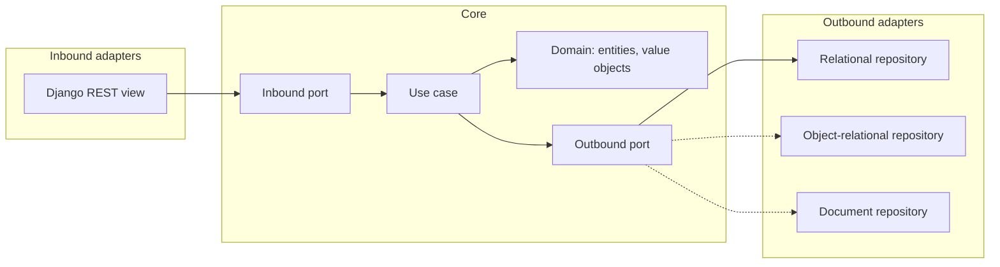
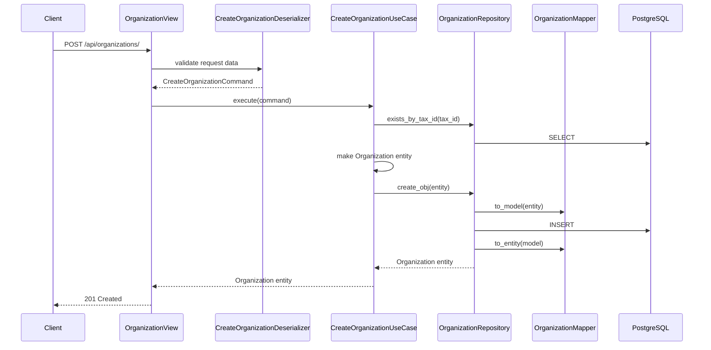
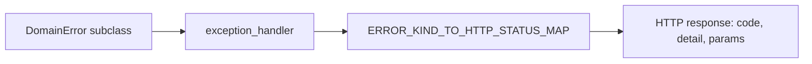

# PROMT 2.0 – Backend application architecture

| | |
|---|---|
| Product | PROMT – Plan • Run • Optimise Management Tool, version 2.0 |
| Scope | Backend application architecture (`backend/app`) |
| Language standard | ASD-STE100 Simplified Technical English |
| Related documents | `docs/PRD-promt-2.0.md`, `docs/schemat/warianty/er-1-relacyjny.drawio` |

---
Last modified: 15.11.2026

## 1. Purpose and scope

This document describes the architecture of the backend application.
The application is in the directory `backend/app`.
The previous implementation is in the directory `backend/api`.

This document gives:
- the structure of the application,
- the rules for the dependencies between the layers,
- the flow of a request through the application,
- the procedure to move a model from `backend/api` to `backend/app`,
- the procedure to add a new use case,
- the known gaps.

This document does not describe the frontend.
This document does not describe the data model fields. The PRD gives the data model fields.

## 2. Previous implementation (`backend/api`)

### 2.1 Structure

The previous implementation is one flat Django application:

| Part | Location | Content |
|---|---|---|
| Models | `api/models/` | 22 Django models. One file for each model. |
| Views | `api/views.py` | Function views: `health`, `me`, `auth_csrf`, `auth_login`, `auth_logout`. |
| URLs | `api/urls.py` | Routes for the function views. |
| Admin | `api/admin.py` | Django admin registration. |
| Commands | `api/management/commands/` | `create_default_super_user`, `generate_erd`. |
| Tests | `api/tests/` | Tests for the e-mail login and the admin. |

### 2.2 Limits

The previous implementation has these limits:
- The business rules are in the Django models. The rules are not separate from the database.
- The views use the Django ORM directly.
- It is not possible to use a different database without a change to the business rules.
  The project must examine three database variants: relational, object-relational and document.
- The application has no layer for use cases.

For these reasons, the team replaced the previous implementation with a new architecture.

### 2.3 Status

The `api` application is not in `INSTALLED_APPS`. Django does not load it.
The `api` directory stays in the repository as a source.
The team moves the models from `api` to `app` one by one (refer to section 10).
When the team moves all models and functions, the team removes the `api` directory.

## 3. Architecture style

The application uses the hexagonal architecture (ports and adapters).

The main rules are:
- The domain is at the center of the application. The domain contains the business rules and the validations.
- The domain does not know adapters. Adapters now include Django and the database implementations.
- The application gets requests through inbound adapters.
- The application keeps data through outbound adapters.
- Ports are the interfaces between the core and the adapters.
- The application has modules. Each module is one business area.
- The module `shared` gives the common parts for all modules: errors, abstract classes, `UNSET` and the exception handler (refer to section 5.6).
- The file `app/dependencies_container.py` connects the ports to the adapters. The core does not know which adapter implements a port (refer to section 8).



The dotted lines show adapters that are not available at this time.

## 4. Modules

| Module | Business area | Models in `app` | Status |
|---|---|---|---|
| `organization` | Organization, members, member groups | `Organization`, `OrganizationMember`, `MemberGroup`, `MemberGroupMember` | 3 use cases and REST endpoints are available. |
| `access` | User accounts, roles, role assignments | `User`, `Role`, `RoleAssignment` | Models and the port `UserPort` are available. There are no use cases. |
| `activity` | Activity log, notifications | `ActivityLog`, `Notification` | Models are available. The port `NotificationPort` is empty. |
| `shared` | Common parts for all modules | none | Errors, base ports, base mapper, `UNSET` value. |

The other 13 models are only in `api/models/`.
The team will add new modules for these models (for example: projects, tasks, finance).

## 5. Layers and directory structure

Each module has the same directory structure:

```text
app/<module>/
├── core/
│   ├── domain/
│   │   ├── entities/          # Domain entities (frozen dataclasses)
│   │   ├── value_objects/     # Value objects with validation
│   │   ├── constants.py       # Domain limits (for example, maximum length)
│   │   └── exceptions.py      # Domain errors
│   ├── application/           # Use cases
│   └── ports/
│       ├── api/               # Inbound ports, commands, queries
│       └── spi/db/repositories/  # Outbound ports (repository interfaces)
└── adapter/
    ├── inbound/django/        # Views, deserializers, URLs
    └── outbound/
        ├── relational_db/     # Django models, mappers, repositories
        ├── object_relational_db/  # Reserved for the object-relational variant
        └── nonrelational_db/  # Reserved for the document variant
```

### 5.1 Domain (`core/domain`)

- An entity is a frozen dataclass with `slots=True`.
- An entity checks its rules in `__post_init__`.
  Example: `Organization` removes the spaces around the name and checks the length of the name.
- A value object holds one value and its rules.
  Example: `OrganizationTaxId` checks the format and the checksum of a Polish tax ID (NIP).
  Example: `OrganizationSettings` checks that there are minimum 3 priority levels.
- A domain error is a subclass of `DomainError`. Each domain error has a `kind` and a `code`.
- The domain must not import adapters or any other framework libraries. The domain must not import Django, DRF or a database library.

### 5.2 Ports (`core/ports`)

- An inbound port (`ports/api`) is a `Protocol` with one method: `execute(command)`.
- A command is a frozen dataclass. It holds the input data for one use case.
- For a partial update, a command field can have the value `UNSET`.
  `UNSET` means: "the client did not send this field". The use case keeps the current value.
- An outbound port (`ports/spi/db/repositories`) is a `Protocol`.
  It gives the operations that the use cases need (for example: `get_by_id`, `create_obj`, `exists_by_tax_id`).
- An outbound port uses domain entities only. It does not use Django models.

### 5.3 Application (`core/application`)

- A use case is a class that implements one inbound port.
- A use case gets its outbound ports through the constructor.
- A use case does these steps:
  1. It reads the data through the outbound ports.
  2. It checks the business rules.
  3. It makes or changes the domain entities.
  4. It writes the entities through the outbound ports.
- A use case raises a domain error when a rule is not correct.

### 5.4 Inbound adapters

#### 5.4.1 Django(`adapter/inbound/django`)

- A view is a DRF `APIView`.
- A view gets the use case through `as_view()`.
- A deserializer validates the format of the request data. It makes a command or query.
- The view calls `execute(command)` and makes the HTTP response.
- The view does not contain business rules.
- The HTTP status comes from the result of the call:
  a successful call returns the status for that operation (for example, 201 for create);
  a domain error returns the status that matches the error `kind` (refer to section 9).

### 5.5 Outbound adapter 

#### 5.5.1 Relational Database (`adapter/outbound/relational_db`)
- A Django model describes one database table.
  Each model has `app_label = "app"` and a `db_table` name from the data model diagram.
- A mapper changes a Django model to a domain entity, and a domain entity to a Django model.
  A mapper implements `BaseMapper`.
- A repository implements one outbound port. It uses the Django ORM and the mapper.
- The database constraints (`CheckConstraint`, `UniqueConstraint`) stay in the Django models.

### 5.6 Shared module (`shared`)

| Part | Location | Function |
|---|---|---|
| `ApplicationError`, `DomainError` | `shared/core/domain/exceptions.py` | Base classes for all errors. A subclass must have `kind` and `code`. |
| `ErrorKind` | `shared/core/domain/error_kind.py` | Error kinds: `invalid`, `not_found`, `conflict`, `not_authorized`, `forbidden`. |
| `BasePort`, `BaseMapper` | `shared/core/ports/spi/db/` | Base interfaces for repositories and mappers. |
| `UNSET`, `is_not_unset` | `shared/core/ports/api/unset.py`, `shared/core/utils.py` | Marker for fields that the client did not send. |
| `exception_handler` | `shared/adapter/inbound/django/exception_handler.py` | Changes a domain error to an HTTP response. |
| `get_container` | `shared/adapter/inbound/django/container.py` | Gives the dependency container to the inbound adapters. |

## 6. Dependency rules

Obey these rules:
- `core/domain` must not import from other layers.
- `core/application` can import only from `core/domain`, `core/ports` and `shared/core`.
- `adapter/*` can import from `core`. The core must not import from `adapter`.
- A module can use the outbound port of a different module.
  Example: `AddOrganizationMemberUseCase` uses `UserPort` from the module `access`.
- Only `dependencies_container.py` connects the ports to the adapters.

## 7. Request flow

Example: the client creates an organization (`POST /api/organizations/`).



The steps are:
1. The view gets the request.
2. The deserializer validates the format of the data. It makes a `CreateOrganizationCommand`.
3. The use case makes an `OrganizationTaxId`. The value object checks the tax ID.
4. The use case asks the repository if the tax ID is already in the database.
   If the tax ID is in the database, the use case raises `TaxIdDuplicationError`.
5. The use case makes an `Organization` entity.
6. The repository changes the entity to a Django model and saves the model.
7. The repository changes the saved model to an entity and returns the entity.
8. The view returns the HTTP response with the status 201.

## 8. Dependency wiring

The file `app/dependencies_container.py` connects the ports to the adapters:
1. The dictionary `RELATIONAL_DB_REPOSITORIES` gives one repository class for each outbound port.
2. `DependenciesContainer._create_repositories()` makes one instance of each repository.
3. `DependenciesContainer._build()` makes the use cases and gives them the repositories.
4. `ApplicationConfig.ready()` (`app/apps.py`) makes the container when Django starts.
5. The module `urls.py` gets the container with `get_container()`.
   It gives each use case to a view through `as_view()`.

To use a different database variant, make a different dictionary of repositories.
The use cases and the domain do not change.

## 9. Error handling



| `ErrorKind` | HTTP status |
|---|---|
| `invalid` | 400 |
| `not_authorized` | 401 |
| `forbidden` | 403 |
| `not_found` | 404 |
| `conflict` | 409 |

The response body has these fields:
- `code` – a stable error code (for example, `organization.member_already_exists`),
- `detail` – the error message,
- `params` – the error parameters.

DRF errors (for example, deserializer errors) go to the default DRF handler.

## 10. Procedure: move a model from `api` to `app`

1. Find the module for the model (refer to section 4). If there is no applicable module, make a new module with the structure in section 5.
2. Copy the model to `app/<module>/adapter/outbound/relational_db/models/<model>.py`.
3. Set `app_label = "app"` and the `db_table` name from the data model diagram in the `Meta` class.
4. Compare the fields with the data model diagram. Correct the differences.
5. Move the business rules from the model to the domain entity and the value objects.
6. Keep the database constraints in the Django model.
7. Add the model to `app/models.py`.
8. Make the migration with `python manage.py makemigrations app`.
9. Write the domain entity in `core/domain/entities/`.
10. Write the mapper in `adapter/outbound/relational_db/mappers/`.
11. Write the outbound port and the repository.
12. Add the port and the repository to `RELATIONAL_DB_REPOSITORIES`.
13. Write the tests. Run `mypy` and `ruff`.

## 11. Procedure: add a use case

1. Write the command in `core/ports/api/commands/`.
2. Write the inbound port in `core/ports/api/`.
3. Add the necessary methods to the outbound port.
4. Write the methods in the repository.
5. Write the use case in `core/application/`.
6. Write the domain errors in `core/domain/exceptions.py`. Set `kind` and `code` for each error.
7. Add the use case to `DependenciesContainer`.
8. Write the deserializer and the view in `adapter/inbound/django/`.
9. Add the route to `adapter/inbound/django/urls.py`.
10. Write the tests for the use case and for the endpoint.

## 12. Known gaps

| # | Gap | Effect |
|---|---|---|
| 1 | The migration `0001_initial` has only `Organization` and `OrganizationMember`. `app/models.py` does not export the other 7 models. | Django does not make the tables `user`, `role`, `role_assignment`, `member_group`, `member_group_member`, `activity_log`, `notification`. |
| 2 | `AUTH_USER_MODEL` is in a comment in `core/settings.py`. | `OrganizationMember.user` refers to the default Django user model, not to `app.User`. |
| 3 | The use cases do not use transactions. | A process with many steps can save part of the data after an error. |
| 4 | The views and the use cases do not check permissions. | All clients can call all endpoints. |
| 5 | `NotificationPort` has no methods. | `AddOrganizationMemberUseCase` does not send an invitation. |
| 6 | `DependenciesContainer.repositories` has the type `dict[type, Any]`. | `mypy` cannot check the types of the repositories. |
| 7 | The directories `object_relational_db` and `nonrelational_db` are empty. | Only the relational variant is available. |
| 8 | The login endpoints are only in `api/views.py`. | The `app` application has no login endpoints. |
