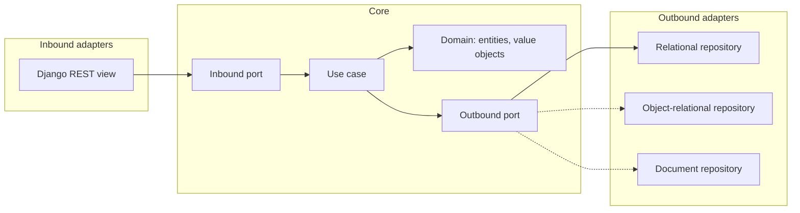
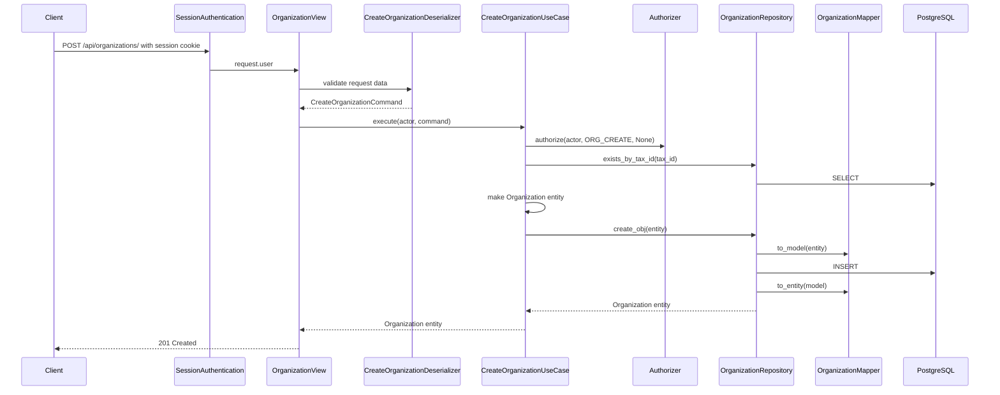
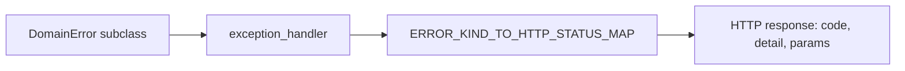

# PROMT 2.0 – Backend application architecture

| | |
|---|---|
| Product | PROMT – Plan • Run • Optimise Management Tool, version 2.0 |
| Scope | Backend application architecture (`backend/app`) |
| Language standard | ASD-STE100 Simplified Technical English |
| Related documents | `docs/PRD-promt-2.0.md`, `docs/schemat/warianty/er-1-relacyjny.drawio` |

---
Last modified: 21.11.2026

## 1. Purpose and scope

This document describes the architecture of the backend application.
The application is in the directory `backend/app`.
The previous implementation is in the directory `backend/api`.

This document gives:
- the structure of the application,
- the rules for the dependencies between the layers,
- the flow of a request through the application,
- the authentication and the authorization,
- the procedure to move a model from `backend/api` to `backend/app`,
- the procedure to add a new use case,
- the known gaps.

This document does not describe the frontend.
This document does not describe the data model fields. The PRD gives the data model fields.

## 2. Previous implementation (`backend/api`)

### 2.1 Structure

The previous implementation is one flat Django application:

| Part | Location | Content |
|---|---|---|
| Models | `api/models/` | 22 Django models. One file for each model. |
| Views | `api/views.py` | Function views: `health`, `me`, `auth_csrf`, `auth_login`, `auth_logout`. |
| URLs | `api/urls.py` | Routes for the function views. |
| Admin | `api/admin.py` | Django admin registration. |
| Commands | `api/management/commands/` | `create_default_super_user`, `generate_erd`. |
| Tests | `api/tests/` | Tests for the e-mail login and the admin. |

### 2.2 Limits

The previous implementation has these limits:
- The business rules are in the Django models. The rules are not separate from the database.
- The views use the Django ORM directly.
- It is not possible to use a different database without a change to the business rules.
  The project must examine three database variants: relational, object-relational and document.
- The application has no layer for use cases.

For these reasons, the team replaced the previous implementation with a new architecture.

### 2.3 Status

The `api` application is not in `INSTALLED_APPS`. Django does not load it.
The `api` directory stays in the repository as a source.
The team moves the models from `api` to `app` one by one (refer to section 11).
When the team moves all models and functions, the team removes the `api` directory.

## 3. Architecture style

The application uses the hexagonal architecture (ports and adapters).

The main rules are:
- The domain is at the center of the application. The domain contains the business rules and the validations.
- The domain does not know adapters. Adapters now include Django and the database implementations.
- The application gets requests through inbound adapters.
- The application keeps data through outbound adapters.
- Ports are the interfaces between the core and the adapters.
- The application has modules. Each module is one business area.
- The module `shared` gives the common parts for all modules: errors, abstract classes, `UNSET` and the exception handler (refer to section 5.6).
- The file `app/dependencies_container.py` connects the ports to the adapters. The core does not know which adapter implements a port (refer to section 8).
- Each use case checks the permission of the user before it does its work (refer to section 10).



The dotted lines show adapters that are not available at this time.

## 4. Modules

| Module | Business area | Models in `app` | Status |
|---|---|---|---|
| `organization` | Organization, members, member groups | `Organization`, `OrganizationMember`, `MemberGroup`, `MemberGroupMember` | 3 use cases and REST endpoints are available. The use cases check permissions. |
| `access` | User accounts, roles, role assignments, login, permissions | `User`, `Role`, `RoleAssignment` | Models, the ports `UserPort` and `OrganizationAccessPort`, `PermissionEnum`, `Authorizer`, the decorator `requires_permission` and the login endpoints are available. There are no use cases. |
| `project` | Projects | `Project` | Only the Django model is available. There are no ports and no use cases. |
| `activity` | Activity log, notifications | `ActivityLog`, `Notification` | Models are available. The port `NotificationPort` is empty. |
| `shared` | Common parts for all modules | none | Errors, base ports, base mapper, `UNSET` value, `Actor`, session authentication, system check. |

The other 12 models are only in `api/models/`.
The team will add new modules for these models (for example: projects, tasks, finance).

## 5. Layers and directory structure

Each module has the same directory structure:

```text
app/<module>/
├── core/
│   ├── domain/
│   │   ├── entities/          # Domain entities (frozen dataclasses)
│   │   ├── value_objects/     # Value objects with validation
│   │   ├── constants.py       # Domain limits (for example, maximum length)
│   │   └── exceptions.py      # Domain errors
│   ├── application/           # Use cases
│   └── ports/
│       ├── api/               # Inbound ports, commands, queries
│       └── spi/db/repositories/  # Outbound ports (repository interfaces)
└── adapter/
    ├── inbound/django/        # Views, deserializers, URLs
    └── outbound/
        ├── relational_db/     # Django models, mappers, repositories
        ├── object_relational_db/  # Reserved for the object-relational variant
        └── nonrelational_db/  # Reserved for the document variant
```

### 5.1 Domain (`core/domain`)

- An entity is a frozen dataclass with `slots=True`.
- An entity checks its rules in `__post_init__`.
  Example: `Organization` removes the spaces around the name and checks the length of the name.
- A value object holds one value and its rules.
  Example: `OrganizationTaxId` checks the format and the checksum of a Polish tax ID (NIP).
  Example: `OrganizationSettings` checks that there are minimum 3 priority levels.
- A domain error is a subclass of `DomainError`. Each domain error has a `kind` and a `code`.
- The domain must not import adapters or any other framework libraries. The domain must not import Django, DRF or a database library.

### 5.2 Ports (`core/ports`)

- An inbound port (`ports/api`) is a `Protocol` with one method: `execute(actor, command)`.
- The actor is an `Actor` (`shared/core/ports/api/actor.py`). It holds the ID of the logged-in user and the value of `is_superuser`.
  The actor is not a part of the command. The use case uses the actor only to check permissions.
- A command is a frozen dataclass. It holds the input data for one use case.
- A command for a use case in one organization has the field `organization_id: int`.
  Such a command agrees with the protocol `OrganizationScopedCommand` (`shared/core/ports/api/organization_scoped_command.py`).
- For a partial update, a command field can have the value `UNSET`.
  `UNSET` means: "the client did not send this field". The use case keeps the current value.
- An outbound port (`ports/spi/db/repositories`) is a `Protocol`.
  It gives the operations that the use cases need (for example: `get_by_id`, `create_obj`, `exists_by_tax_id`).
- An outbound port uses domain entities only. It does not use Django models.

### 5.3 Application (`core/application`)

- A use case is a class that implements one inbound port.
- A use case gets its outbound ports and the `Authorizer` through the constructor.
  The use case must keep the `Authorizer` in the attribute `self._authorizer`.
- The method `execute` has the decorator `@requires_permission(PermissionEnum.<VALUE>)` (refer to section 10.2).
- A use case does these steps:
  1. The decorator checks the permission of the actor. If the check fails, the body of `execute` does not start.
  2. It reads the data through the outbound ports.
  3. It checks the business rules.
  4. It makes or changes the domain entities.
  5. It writes the entities through the outbound ports.
- A use case raises a domain error when a rule is not correct.

### 5.4 Inbound adapters

#### 5.4.1 Django(`adapter/inbound/django`)

- A view is a DRF `APIView`.
- A view gets the use case through `as_view()`.
- A view requires a logged-in user. Only the views in section 10.1 allow anonymous access.
- A deserializer validates the format of the request data. It makes a command or query.
- The view makes the actor with `actor_from_request(request)`.
- The view calls `execute(actor, command)` and makes the HTTP response.
- The view does not contain business rules.
- The HTTP status comes from the result of the call:
  a successful call returns the status for that operation (for example, 201 for create);
  a domain error returns the status that matches the error `kind` (refer to section 9).

### 5.5 Outbound adapter

#### 5.5.1 Relational Database (`adapter/outbound/relational_db`)
- A Django model describes one database table.
  Each model has `app_label = "app"` and a `db_table` name from the data model diagram.
- A mapper changes a Django model to a domain entity, and a domain entity to a Django model.
  A mapper implements `BaseMapper`.
- A repository implements one outbound port. It uses the Django ORM and the mapper.
- The database constraints (`CheckConstraint`, `UniqueConstraint`) stay in the Django models.

### 5.6 Shared module (`shared`)

| Part | Location | Function |
|---|---|---|
| `ApplicationError`, `DomainError` | `shared/core/domain/exceptions.py` | Base classes for all errors. A subclass must have `kind` and `code`. |
| `ErrorKind` | `shared/core/domain/error_kind.py` | Error kinds: `invalid`, `not_found`, `conflict`, `not_authorized`, `forbidden`. |
| `BasePort`, `BaseMapper` | `shared/core/ports/spi/db/` | Base interfaces for repositories and mappers. |
| `UNSET`, `is_not_unset` | `shared/core/ports/api/unset.py`, `shared/core/utils.py` | Marker for fields that the client did not send. |
| `Actor` | `shared/core/ports/api/actor.py` | The logged-in user that calls a use case. |
| `OrganizationScopedCommand` | `shared/core/ports/api/organization_scoped_command.py` | Protocol for a command with `organization_id`. |
| `exception_handler` | `shared/adapter/inbound/django/exception_handler.py` | Changes a domain error to an HTTP response. |
| `get_container` | `shared/adapter/inbound/django/container.py` | Gives the dependency container to the inbound adapters. |
| `SessionAuthentication` | `shared/adapter/inbound/django/authentication.py` | DRF session authentication that returns 401 (not 403) when there is no session. |
| `actor_from_request` | `shared/adapter/inbound/django/actor.py` | Makes an `Actor` from `request.user`. |
| `check_public_endpoints`, `PUBLIC_ENDPOINT_NAMES` | `shared/adapter/inbound/django/checks.py`, `shared/adapter/inbound/django/constants.py` | System check: only the routes in `PUBLIC_ENDPOINT_NAMES` can use `AllowAny`. |

## 6. Dependency rules

Obey these rules:
- `core/domain` must not import from other layers.
- `core/application` can import only from `core/domain`, `core/ports` and `shared/core`.
- `adapter/*` can import from `core`. The core must not import from `adapter`.
- A module can use the outbound port of a different module.
  Example: `AddOrganizationMemberUseCase` uses `UserPort` from the module `access`.
- A use case of a module can import `Authorizer` and `requires_permission` from `access/core/application`
  and `PermissionEnum` from `access/core/domain`. This is the only permitted import from the application layer of a different module.
- Only `dependencies_container.py` connects the ports to the adapters.

## 7. Request flow

Example: the client creates an organization (`POST /api/organizations/`).



The steps are:
1. DRF finds the user from the session cookie. If there is no session, DRF returns 401.
2. The view gets the request and makes the actor with `actor_from_request(request)`.
3. The deserializer validates the format of the data. It makes a `CreateOrganizationCommand`.
4. The decorator `requires_permission` calls the `Authorizer`.
   `CreateOrganizationCommand` has no `organization_id`, thus only a superuser gets access (refer to section 10.2).
5. The use case makes an `OrganizationTaxId`. The value object checks the tax ID.
6. The use case asks the repository if the tax ID is already in the database.
   If the tax ID is in the database, the use case raises `TaxIdDuplicationError`.
7. The use case makes an `Organization` entity.
8. The repository changes the entity to a Django model and saves the model.
9. The repository changes the saved model to an entity and returns the entity.
10. The view returns the HTTP response with the status 201.

## 8. Dependency wiring

The file `app/dependencies_container.py` connects the ports to the adapters:
1. The dictionary `RELATIONAL_DB_REPOSITORIES` gives one repository class for each outbound port.
2. `DependenciesContainer._create_repositories()` makes one instance of each repository.
3. `DependenciesContainer._build()` makes one `Authorizer` and the use cases. It gives the repositories and the `Authorizer` to the use cases.
4. `DependenciesContainer._verify_authorization()` examines each attribute of the container that has the method `execute`.
   If `execute` does not have the decorator `requires_permission`, or the use case does not keep an `Authorizer` in `self._authorizer`,
   the container raises `ImproperlyConfigured` and Django does not start.
5. `ApplicationConfig.ready()` (`app/apps.py`) makes the container when Django starts.
   It also registers the system check `check_public_endpoints` (refer to section 10.3).
6. The module `urls.py` gets the container with `get_container()`.
   It gives each use case to a view through `as_view()`.

The container is made one time. Do not give data from a request to the constructor of a use case.

To use a different database variant, make a different dictionary of repositories.
The use cases and the domain do not change.

## 9. Error handling



| `ErrorKind` | HTTP status |
|---|---|
| `invalid` | 400 |
| `not_authorized` | 401 |
| `forbidden` | 403 |
| `not_found` | 404 |
| `conflict` | 409 |

The response body has these fields:
- `code` – a stable error code (for example, `organization.member_already_exists`),
- `detail` – the error message,
- `params` – the error parameters.

DRF errors (for example, deserializer errors, a missing session or a missing CSRF token) go to the default DRF handler.

## 10. Authentication and authorization

### 10.1 Authentication

The application uses Django sessions and CSRF protection. The application does not use JWT.
The user account and the login stay in Django and PostgreSQL for all database variants.

- `core/settings.py` sets these DRF defaults for all views:
  `DEFAULT_AUTHENTICATION_CLASSES` = `SessionAuthentication` (from `shared`) and `DEFAULT_PERMISSION_CLASSES` = `IsAuthenticated`.
- A request without a session gets 401.
- `AUTH_USER_MODEL` is `app.User`. The e-mail is the login.
- The login endpoints are a thin inbound adapter in `access/adapter/inbound/django/`. They use `django.contrib.auth` directly. They do not use a use case.

| Method | Path | Route name | Access | Function |
|---|---|---|---|---|
| GET | `/api/access/csrf/` | `access-csrf` | anonymous | Sets the CSRF cookie. |
| POST | `/api/access/login/` | `access-login` | anonymous, CSRF token necessary | Opens a session. Returns the user data. |
| POST | `/api/access/logout/` | `access-logout` | logged-in user | Closes the session. Returns 204. |
| GET | `/api/access/me/` | `access-me` | logged-in user | Returns the user data: `id`, `email`, `first_name`, `last_name`, `is_staff`. |

The login procedure for a client:
1. Send `GET /api/access/csrf/`. Keep the cookie `csrftoken`.
2. Send `POST /api/access/login/` with `email` and `password`. Put the value of `csrftoken` in the header `X-CSRFToken`.
3. Send the header `X-CSRFToken` with each request that changes data.

A wrong password and an account with `is_active=False` give the same error: 401 with the code `access.invalid_credentials`.

### 10.2 Authorization

Each use case checks the permission of the actor.

- `PermissionEnum` (`access/core/domain/enums/permission_enum.py`) is the list of permission codes:

  | Value | Code | Use case |
  |---|---|---|
  | `ORG_CREATE` | `org.create` | `CreateOrganizationUseCase` |
  | `ORG_SETTINGS` | `org.settings` | `UpdateOrganizationSettingsUseCase` |
  | `MEMBER_MANAGE` | `member.manage` | `AddOrganizationMemberUseCase` |

- A role (`role.permissions`) holds permission codes. The `name` of the role identifies the role.
- The decorator `requires_permission(permission)` (`access/core/application/requires_permission.py`) wraps `execute(actor, command)`.
  It reads `organization_id` from the command if the command agrees with `OrganizationScopedCommand`.
  Then it calls `self._authorizer.authorize(actor, permission, organization_id)`.
- `Authorizer` (`access/core/application/authorizer.py`) gets the access data through `OrganizationAccessPort.get_organization_access(user_id, organization_id)`.
- The effective permissions of a member in an organization are the sum of the permissions of:
  the roles given to the member, the roles given to the groups of the member and the roles given to the parent groups of these groups.
  Only the role assignments without a project (`project_id IS NULL`) count.
- The relational adapter (`OrganizationAccessRepository`) gets the access data with one SQL query (`WITH RECURSIVE`).
  It ignores codes in `role.permissions` that are not in `PermissionEnum`.

The `Authorizer` does these checks in this sequence:

| # | Condition | Result |
|---|---|---|
| 1 | The actor has `is_superuser`. | Access is permitted. |
| 2 | The command has no `organization_id`. | 403, `access.access_denied`. Only a superuser can use such a use case. |
| 3 | The organization does not exist, the organization is not active, or the user is not a member. | 404, `access.organization_not_found`. The response does not show that the organization exists. |
| 4 | The member status is not `active` (`invited`, `suspended`, `left`). | 403, `access.inactive_membership`. |
| 5 | The effective permissions do not have the permission. | 403, `access.access_denied`. |

`is_staff` gives no application permissions. It only opens the Django admin.

### 10.3 Enforcement of the rules

- Authentication: the system check `check_public_endpoints` (ID `app.E001`) examines all routes when Django starts.
  If a DRF view uses `AllowAny` and its route name is not in `PUBLIC_ENDPOINT_NAMES`, the check gives an error.
  To add an anonymous endpoint, add its route name to `PUBLIC_ENDPOINT_NAMES`.
- Authorization: `DependenciesContainer._verify_authorization()` stops the start of Django if a use case has no `requires_permission` (refer to section 8).

## 11. Procedure: move a model from `api` to `app`

1. Find the module for the model (refer to section 4). If there is no applicable module, make a new module with the structure in section 5.
2. Copy the model to `app/<module>/adapter/outbound/relational_db/models/<model>.py`.
3. Set `app_label = "app"` and the `db_table` name from the data model diagram in the `Meta` class.
4. Compare the fields with the data model diagram. Correct the differences.
5. Move the business rules from the model to the domain entity and the value objects.
6. Keep the database constraints in the Django model.
7. Add the model to `app/models.py`.
8. Make the migration with `python manage.py makemigrations app`.
9. Write the domain entity in `core/domain/entities/`.
10. Write the mapper in `adapter/outbound/relational_db/mappers/`.
11. Write the outbound port and the repository.
12. Add the port and the repository to `RELATIONAL_DB_REPOSITORIES`.
13. Write the tests. Run `mypy` and `ruff`.

## 12. Procedure: add a use case

1. Write the command in `core/ports/api/commands/`. If the use case is in one organization, add the field `organization_id: int`.
2. Write the inbound port in `core/ports/api/`. The method is `execute(self, actor: Actor, command: <Command>)`.
3. Find the applicable value in `PermissionEnum`. If there is no applicable value, add a new value.
4. Add the necessary methods to the outbound port.
5. Write the methods in the repository.
6. Write the use case in `core/application/`. Get the `Authorizer` in the constructor and keep it in `self._authorizer`.
   Put the decorator `@requires_permission(PermissionEnum.<VALUE>)` on `execute`.
7. Write the domain errors in `core/domain/exceptions.py`. Set `kind` and `code` for each error.
8. Add the use case to `DependenciesContainer`. Give it `self.authorizer`.
9. Write the deserializer and the view in `adapter/inbound/django/`. The view calls `execute(actor_from_request(request), command)`.
10. Add the route to `adapter/inbound/django/urls.py`.
11. Write the tests for the use case and for the endpoint.

## 13. Known gaps

| # | Gap | Effect |
|---|---|---|
| 1 | The directory `app/migrations` has no migration. `app/models.py` does not export `ActivityLog` and `Notification`. | Run `python manage.py makemigrations app` before the first start. Django does not make the tables `activity_log` and `notification`. |
| 2 | The use cases do not use transactions. | A process with many steps can save part of the data after an error. |
| 3 | `NotificationPort` has no methods. | `AddOrganizationMemberUseCase` does not send an invitation. |
| 4 | `DependenciesContainer.repositories` has the type `dict[type, Any]`. | `mypy` cannot check the types of the repositories. |
| 5 | The directories `object_relational_db` and `nonrelational_db` are empty. | Only the relational variant is available. |
| 6 | The permissions of `is_staff` are not decided. | `is_staff` gives no application permissions. |
| 7 | `OrganizationAccessPort` has no project scope. | Role assignments with a project do not give permissions. |
| 8 | The frontend (`frontend/src/features/auth/authApi.ts`) uses the paths `/api/auth/...`. | The frontend login does not work until the paths change to `/api/access/...`. |
| 9 | `PermissionEnum` has only 3 codes. The PRD catalog (section 3.4) has more codes. | Add a code when a use case needs it. |
| 10 | `requirements.txt` contains `djangorestframework_simplejwt`. | The application does not use the package. |
